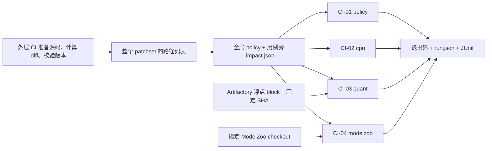

# GPTQModel 项目 CI 全貌

当前交付由四部分组成：4 个可执行 lane、按变更自动发现的测试、分层 AGENTS 规则、
以及 Artifactory 上可校验的浮点 block。Jenkins/Gerrit 的平台配置由 CI 同事负责。



四个 lane 共用 `tests/ci/run.sh`，按变更选择适用的测试；无需为每个模型增加平台任务。
本仓已登记的测试、声明、执行脚本与资源清单全部位于 `tests/ci/`。
runner/selector 不调用 Git，不读取 `.git`；空列表只跑 policy，未提供列表按未知变更跑全集。

## 1. 流水线与证据

| 编号 | 入口 | 当前登记 | 验证什么 |
| --- | --- | --- | --- |
| CI-01 | `--lane policy` | 2 个文件，53 项检查 | 外部 diff、无 Git 入口、声明合法性、漏映射、增删/rename、失败与 skip、报告/下载校验 |
| CI-02 | `--lane cpu` | 19 个文件 | recipe/API、校准、模块树、打包、W4/W5 head 保存重载、block 切片、Ling HF 缓存兼容 |
| CI-03 | `--lane quant` | 4 个文件/node，展开 11 组真实量化 | Qwen3.5 ×4、Qwen3-Next ×3、Ling ×4 |
| CI-04 | `--lane modelzoo` | 5 个消费方文件 | 双方 recipe/CLI、XH dtype、head、Ling MLA 载荷消费 |
| CI-05 | 定时/手动，待接入 | 尚无独立入口 | 原尺寸多架构量化、质量/性能、长上下文与专项机制 |
| CI-06 | release，待接入 | 尚无独立入口 | wheel、独立安装、资源完整性与双方候选版本兼容 |

现有运行证据：CPU 初始完整集 181 项（当时测试集合），Ling 增量 CPU 60 项、额外 MLA
13 项；消费方完整集 141 项、Ling 改动消费集 106 项。它们是不同时间/范围的记录，
不能相加为一次完整运行。目录迁移后，当前 18 个 CPU 文件与 41 项 policy 一起执行，
共 222 项通过、无 skip；报告位于 `artifacts/ci/qtl491-layout/cpu/`。

GPU 的 11 组分别已运行通过，不是本轮上传时重新量化了一遍：

| 代表集 | 组合 | 关键断言 |
| --- | --- | --- |
| Qwen3.5 dense | GPTQ/AutoRound × W4/W8，G64 | 两种 attention 都实际量化、packed/config、真实 loader 重载与有限前向 |
| Qwen3-Next | 3 组 XH 混合精度/MTP | hybrid attention、MoE/MTP、保存前后整数载荷与同 dtype logits 一致 |
| Ling3.0 Flash | 原 MLA AutoRound（MTP 0/1）；吸收 MLA GPTQ/AutoRound | KDA 校准、MLA 吸收、MoE、MTP 保留、整数载荷重存、MLA prefill/decode |

Qwen3-Next 与 Ling 使用缩小维度的真实模型代码；Qwen dense 使用裁剪后的原始权重。
当前专项缺口包括原尺寸 MoE/Gemma/Ling 的完整量化、dense XH 网格补充、KDA cached decode、
多模态量化和质量阈值。详见 [能力矩阵](quantization-matrix.md)。

## 2. Artifactory 输入

脚本 `/data01/modelzoo2/upload.sh` 对应的实际仓库名是 `model_zoo2`。
本批资源位于 `model_zoo2/ci/gptqmodel-blocks-v1/`；资源目录、下载表与校验命令见
[发布资源](fixtures/README.md#artifactory-发布资源)。

| 浮点 block | 文本层数 | 原层号 | 保留机制 |
| --- | ---: | --- | --- |
| Qwen3.5 dense | 2 | 0、3 | linear/full attention |
| Qwen3.5 MoE | 2 | 0、3 | 两种 attention、routed/shared expert、原路由 |
| Gemma4 E2B | 4 | 13、14、15、19 | sliding/full KV donor/borrower、per-layer input |
| Gemma4 MoE | 2 | 0、5 | sliding/full attention、原 expert/路由 |
| Ling3.0 Flash | 3 | 0、2、5 | KDA/dense、KDA/MoE、MLA/MoE，512 experts |

5 个 block 都保留原宽度和 expert 数，并已通过 HF key/shape 与 BF16 文本前向。
除了 Qwen dense，其余原尺寸 block 还没有完整量化证据；不要与上面的缩小维度量化用例混淆。
ModelZoo 已有的已量化 block 继续供其导出/消费 CI 使用，本批上传的是量化输入。

Qwen dense guard 默认使用本批固定 URL/SHA；也可显式指定本地目录或自定义 URL+SHA。
Ling CPU/quant 默认下载固定 SHA 的 21 KB 代码包，用原 config 与模型源码生成小模型，
不读取 13 GiB 权重。`LING3_FLASH_CODE_CACHE` 控制缓存，可离线复用；
`LING3_FLASH_MODEL_DIR` 仅用于显式指定已有配置/源码目录，缺文件会报错。
发布清单包含归档及各文件摘要、原层号、来源和验证边界。内容变化发布新版本。

## 3. 新适配如何接入

新增独立 family/function 通常只新增实现、测试、同名 `.impact.json`：

```text
gptqmodel/recipes/new_family.py
tests/ci/test_new_family.py
tests/ci/test_new_family.impact.json
```

测试声明自己的实现/输入和资源类别 `cpu` 或 `quant`。selector 自动发现，新增功能不用
改旧声明或集中测试清单；所有匹配取并集，共享实现仍回归旧消费者。新 CI 测试缺声明、
声明无测试、受保护实现没有生产端映射直接失败，`--all` 不绕过。
独立增加模型名可以复用算法代表集；引入新的层结构、数值语义或权重布局需要新增真实量化。

AGENTS 按职责分层：根目录约束生产端/消费端边界；`gptqmodel/recipes/` 约束公开参数、
执行和 provenance；`tests/ci/` 约束声明、fixture、证据与失败处理。具体命令放在 README。

## 4. CI 同事接入什么

固定 Python/依赖、准备 fixture 缓存、checkout 并校验双方版本、传入整个 patchset 路径列表，
然后按 lane 调用 `run.sh`。GPU 分配/互斥、平台任务和触发由 CI 同事配置。

```bash
PYTHON=/path/to/env/bin/python tests/ci/run.sh --lane policy
PYTHON=/path/to/env/bin/python tests/ci/run.sh --lane cpu --changed-files-file changes.json
CUDA_VISIBLE_DEVICES=<allocated-device> \
  PYTHON=/path/to/env/bin/python tests/ci/run.sh --lane quant --changed-files-file changes.json
PYTHON=/path/to/modelzoo-env/bin/python tests/ci/run.sh --lane modelzoo \
  --changed-files-file changes.json --modelzoo-dir /path/to/xh2modelzoo \
  --gptqmodel-commit <producer-commit> --modelzoo-commit <consumer-commit>
```

需要全量登记集用 `--all`，查看计划用 `--dry-run`。缺环境/模型或出现 skip 不算通过。
commit 参数只记录外部输入；未提供时报告未知，不由 runner 查询或校验。
收集 `artifacts/ci/<lane>/{run.json,junit.xml}` 与 console 日志；详细版本和超时约定见
[执行说明](README.md)。仓库没有 Jenkinsfile。
